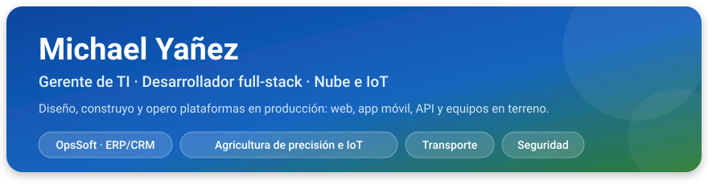
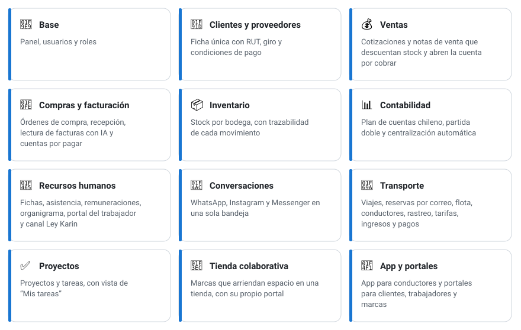
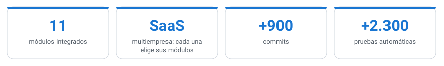
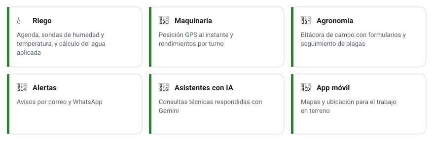
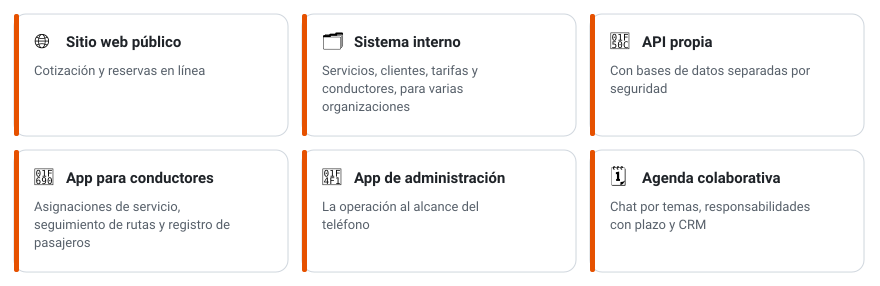

**Del requerimiento a la puesta en marcha, para agroindustria, transporte, comercio y servicios.**

&nbsp;

---

## 🧑‍💻 Sobre mí

- 🧭 **Gerente de TI**: dirijo la tecnología, la seguridad de la información y el equipo de desarrollo, y sigo diseñando y programando los sistemas que lidero.
- 🏢 Creé **OpsSoft**, un **ERP/CRM SaaS multiempresa** para pymes chilenas, ya en uso: 11 módulos, desde ventas y contabilidad hasta recursos humanos y transporte.
- 🌱 Desarrollo una **plataforma de agricultura de precisión e IoT** para una operación agrícola de gran escala, conectada a sensores y maquinaria en terreno.
- 🚐 Construí el **ecosistema digital de una empresa de transporte**: web y reservas, sistema interno, API y apps móviles.
- 🔐 En 2026 lideré una **evaluación de seguridad integral** de una plataforma en producción. Aplico control de acceso por roles, credenciales fuera del código, revisión de dependencias y despliegues verificados.
- 🤖 Aplico **inteligencia artificial** en productos reales: lectura de facturas, asistentes para consultas técnicas y atención de clientes.

---

## 🚀 Proyectos destacados

### 🏢 OpsSoft · ERP/CRM SaaS para pymes chilenas

   

**El producto.** Plataforma de gestión multiempresa, ya en uso. Cada empresa contrata solo los módulos que necesita: ventas, compras, inventario, contabilidad, recursos humanos, conversaciones, transporte, proyectos y más.

<picture>
  <source media="(prefers-color-scheme: dark)" srcset="https://raw.githubusercontent.com/Rhapcore/Rhapcore/imagenes/opssoft-modulos-oscuro.svg">
  
</picture>

**Apps y portales.** Panel de la empresa, sitio web, API, **app móvil para conductores** y portales para clientes, trabajadores y marcas.

**Alcance.** Por diseño, no hace trámites ante organismos públicos como el SII o Previred.

**Mi rol.** Producto, arquitectura y desarrollo completo.

<picture>
  <source media="(prefers-color-scheme: dark)" srcset="https://raw.githubusercontent.com/Rhapcore/Rhapcore/imagenes/opssoft-cifras-oscuro.svg">
  
</picture>

**Tecnología**

           

 

### 🌱 Plataforma de agricultura de precisión e IoT

   

**El desafío.** Una operación agrícola de gran escala necesitaba centralizar el riego, la maquinaria y el estado de los cultivos, con información que estaba repartida o en papel.

**La solución.** Una plataforma web y móvil organizada por áreas:

<picture>
  <source media="(prefers-color-scheme: dark)" srcset="https://raw.githubusercontent.com/Rhapcore/Rhapcore/imagenes/agro-areas-oscuro.svg">
  
</picture>

**Mi rol.** Arquitectura y desarrollo de la plataforma web, la API y la app; integración con los equipos en terreno; despliegues y liderazgo del equipo de desarrollo.

**Resultados**

<picture>
  <source media="(prefers-color-scheme: dark)" srcset="https://raw.githubusercontent.com/Rhapcore/Rhapcore/imagenes/agro-cifras-oscuro.svg">
  
</picture>

La web carga un **41 % menos de código al inicio** gracias a la descarga de pantallas bajo demanda, y las **credenciales viven fuera del código**, en un gestor de secretos.

**Decisiones de diseño.** La telemetría se resume en la plataforma IoT según el rango consultado, sin descargar datos crudos. Los datos meteorológicos, que se cobran por consulta, se piden desde el servidor y quedan en caché.

**Tecnología**

      

 

### 🚐 Ecosistema digital para una empresa de transporte

 

**Qué incluye.** Las herramientas que la empresa usa para operar:

<picture>
  <source media="(prefers-color-scheme: dark)" srcset="https://raw.githubusercontent.com/Rhapcore/Rhapcore/imagenes/transporte-oscuro.svg">
  
</picture>

**Mi rol.** Desarrollo y mantención de la web, el sistema interno, la API y las apps.

**Tecnología**

     

 

### 🗺️ Optimización de rutas · SaaS para empresas de transporte

 

Producto multiempresa para planificar y gestionar rutas, y comunicarse con los clientes por WhatsApp.

- **API** documentada con OpenAPI (Swagger), sobre MongoDB Atlas.
- **Web del producto** con componentes propios y diseño consistente.
- **Despliegue** con Docker Compose en una máquina virtual.

       

 

### 🛰️ Monitoreo satelital de cultivos

 

Procesamiento diario de imágenes satelitales: índices de vegetación por campo y por sector, con historial y reprocesamiento automático.

   

 

### 🏙️ Portal de comercio y turismo local

 

Portal público con dominio propio, que da visibilidad a negocios, servicios, instituciones y experiencias de una ciudad.

- **Mapa público** con los negocios, a partir de sus direcciones.
- **Cuentas de usuario** con registro, verificación de correo y recuperación de contraseña.
- **Panel administrativo** de usuarios, negocios, planes, mensajes y contenido visual.
- **Despliegue continuo** con GitHub Actions a Cloud Run.

       

 

### 🛒 Otros proyectos

- **Tiendas en línea** con catálogo, carro de compras, inventario y panel de ventas.
- **Bandeja de mensajes para un salón de belleza**: WhatsApp e Instagram en un solo lugar.

---

## 🛠️ Tecnologías

**Lenguajes**

   

**Web y móvil**

     

**Backend y nube**

       

**Mapas y datos**

 

**Calidad y despliegue**

 

**IA y mensajería**

  

---

## 📫 Conversemos

¿Necesitas llevar a producción una plataforma web, móvil o IoT, o un sistema de gestión para tu empresa? Escríbeme a **[michaelyanezortega@hotmail.com](mailto:michaelyanezortega@hotmail.com)** o por WhatsApp al **[+56 9 8214 5857](https://wa.me/56982145857)**.

&nbsp;

Referencias disponibles a pedido.
